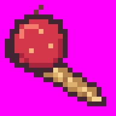

# Beetle Berry Run · Aim the chute, shape the bounce

This return project combines Reed and Clay after the picnic discovery. A giant berry waits at the top of a forked reed chute. One player aims the chute toward the garden or shade. The other shapes a clay bank into a low channel or a high pocket. The right combination leaves a scent trail that brings the picnic beetle to the cottage garden.

## Two jobs, four outcomes

| Reed chute | Clay bank | Outcome |
|---|---|---|
| Garden | Low channel | Berry rolls to the garden bed. The beetle follows and becomes a visitor. |
| Garden | High pocket | The pocket catches the berry. The beetle peers over the bank. |
| Shade | Low channel | Berry rolls into the leaf bed. The beetle follows, then walks home. |
| Shade | High pocket | The pocket catches the berry beside its burrow. The beetle pauses there. |

The reusable berry returns to its cradle after every response. Both settings remain selected so the family can discuss which one to change. After success, ask the players to swap jobs and try another response. A solo player sets the chute and clay, then launches.

Open [beetle-run.html](beetle-run.html) for the shared-screen rehearsal. It fixes the outcomes so the family can form a prediction before pressing Launch. The live version should show the ground tracks, basket height and berry path without text.

## Why it differs from the earlier discoveries

- Reed pool redirects moving cargo after launch. Here, the family commits two independent choices before launch.
- Clay bank teaches one ramp with two release distances. Here, the same berry must reach two targets at different heights and directions.
- The three non-winning routes produce distinct beetle reactions and return the berry without a penalty.
- The project produces a character visit and garden animation. It does not add another permanent resource multiplier or checklist.

When the garden and low channel align, the beetle follows the scent trail to the cottage garden. On later visits it rolls out one ordinary berry for immediate play, then naps. That berry uses the normal round economy when collected. Replaying the chute produces beetle reactions and no additional permanent unlock.

## Claude handoff

- Keep the giant berry as a dedicated project prop. It cannot enter ordinary carry, auto-collect, home deposit or quest progress while it is in the chute.
- The host records chute side and clay shape when Launch starts. Ignore another launch until the berry returns or settles. Resolve simultaneous setting presses in stable player-ID order.
- Every route ends at the ready cradle. Record completion only when the beetle reaches the garden, before the celebration. An unfinished attempt resets to ready on reload.
- Include choices, attempt ID, roll phase, berry path progress and beetle response in snapshots so late joiners see the same run. On disconnect, keep an active run moving. On reload, reset the berry to ready and restore the garden visitor.
- Reserve both target approaches, berry paths and the return trough before seeded nodes are generated. Derive named sockets from the current corner layout rather than saving coordinates.
- Use the common contextual selector and one physical action edge. Held tool repeats, auto-gather and dash cannot also aim, shape or launch.

## Acceptance

Test all four combinations, repeated non-winning routes, duplicate launch, simultaneous conflicting settings, solo play, role swap, late join, disconnect mid-run, reload before and after beetle arrival, unavailable storage on completion and all four corner orientations. Confirm that carry, bank, quest progress and magnet effects never touch the project berry.

Ask both players which setting made the berry miss and what they want the other person to change. The project succeeds when they negotiate the second shot without one player taking both controls.

## Sprite handoff

The [native strip](art/beetle-run.png) contains four 24 × 24 cells showing ready, chute, low channel and garden arrival states. Use exact RGB(255, 0, 255) as the key and nearest-neighbour scaling. The GIF is a review loop. The live path should hold ready and arrival states, while rolling frames follow host-authored motion.

## Checkpoint · 19 November 2026

The project now has a deterministic four-outcome rehearsal, one persistent beetle visit and an implementation handoff. Real movement, two-phone coordination and economy tuning for the beetle’s visit berry remain open.
