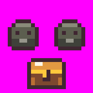

# First shared chest · Make the missing helper obvious

This study completes priority one from the family-play review without changing the live game. The current chest already needs two nearby blobz, averages their movement and shows two generic helper silhouettes. The gap is discovery: the first chest can appear far away, and a broken carry does not say who should return.

## Smallest first outing

When the meadow team first grows from one to two players, place one ordinary co-op chest at a reserved clear socket within the cottage camera. Do not wait for the random eight-second spawn or use `freeSpot(..., 260)`. This is the same chest, reward and carry rule as later chests; only its first location and teaching cue differ.

1. Both helper pips begin dim. A blob entering the existing 62-world-pixel grab radius lights one pip in that blob's colour.
2. With exactly one helper nearby, pulse the empty pip and put one inward chevron over the nearest connected blob outside the ring. The host tie-breaks equal distance by player ID so every phone names the same useful helper.
3. With two or more nearby, light both pips and lift the chest. Keep the current averaged-velocity steering: moving together is fastest, opposite movement holds position, and one moving partner can still pull slowly while the other stays close.
4. When contact drops below two, the chest brakes under the existing rule. The departed or nearest available helper gets the chevron; do not show a failure cross, timer or lost reward.
5. Delivery uses the current `GEM_BUNDLE` once. With stone archived, the visible recap should name only active resources. Normal random chests can begin after this one is delivered.

Open [carry-chest.html](carry-chest.html) for a deterministic shared-screen rehearsal. Start with Blue close and Orange outside. Advance once to see who is called, bring Orange in, point both players toward home and advance again. Then deliberately point them in opposite directions or break contact. The cue succeeds when the waiting player says who should move without reading instructions.

## Why this is not another tutorial panel

- The two pips are already present in [game.ts](../../../src/game.ts); colour and the missing-helper chevron add a consequence to them.
- The chest remains a physical invitation beside the cottage, visible while both players learn their own movement.
- No action button, modal, recipe, inventory slot or permanent tutorial flag is required.
- Later chests use the same cue, so the first outing teaches a reusable co-op language.

## Claude handoff

- Give the first fixture a host-owned `intro` identity, deterministic reserved socket and `unseen | active | done` session phase. Spawn it once on the transition to two connected players. Keep it through a disconnect; do not spawn a duplicate on rejoin or late join.
- The host computes nearby IDs with the existing strict `< 62` test, sorted by distance then player ID. Include the fixture identity, two visual helper IDs and optional called-helper ID in the gem snapshot. This avoids rounded client positions disagreeing at the ring edge. Old snapshots without these optional fields keep the generic two-pip cue and never invent a named helper.
- Render the two pips with the selected players' actual blob colours. More than two nearby players may all influence the existing averaged velocity, but the two closest fill the teaching pips. Re-evaluate without ownership locks so a third player can replace someone who leaves.
- Show the inward chevron only while exactly one helper is within 62. With one connected player total, leave the second pip dim and say the chest is waiting; there is nobody to blame or point at.
- Reserve the socket before trees, build plots and the dungeon entrance are finalised. Keep it outside the cottage delivery trigger so it cannot score at spawn. Start normal `gemT` only after delivery or after the fixture is explicitly removed by a test reset.
- Keep reward, movement, braking and bank mutation host-authoritative. A client-side cue must never decide proximity or award resources.

## Acceptance

Test zero, one, two, three and five nearby players; the strict 62-pixel boundary; equal-distance tie breaks; one idle helper; opposite velocities; disconnect and rejoin; late join while carried; delivery on the same tick as contact loss; duplicate snapshots and old snapshots without helper IDs. Confirm only one reward fires, the one-player meadow never spawns an impossible task and normal chest spawning resumes.

At portrait and short-landscape phone sizes, keep the chest, two pips, both participating blobz and the called helper visible together. Cover all explanatory text and ask each player, “Who needs to move?” A colour-only answer is insufficient: the pulsing silhouette and chevron must still work for colour-vision differences.

## Sprite handoff

The [native strip](art/carry-chest-cue.png) contains four 24 × 24 cells: waiting, one helper, carrying and broken contact. Key out exactly RGB(255, 0, 255) and scale with nearest-neighbour sampling. The chest stays anchored between frames; only pips, lift and the inward cue animate. The GIF is a review loop, not timing authority.

## Checkpoint · 19 November 2026

The first shared outing now has a deterministic chest placement, host-authoritative helper selection, playable rehearsal, authored cue frames and host/snapshot acceptance cases. Real phone framing, colour assignment with customised blobz and two-phone comprehension remain open.
