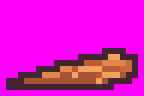

# Clay bank · Shape the jump

From the reed flower, a child can see wheel-like tracks leading to a ditch. A round stone sits in a groove. Its last print is pressed into a patch of orange clay. Beyond the ditch, a log balances on its end. Above the near bank, a seed bell hangs just out of reach. Which one will the family try to hit?

**The thing worth discovering is that clay keeps the shape you give it.** Press the clay flat to send the stone skimming across the ditch. Pinch it up to send the stone toward the bell. The roller chooses the release groove. The sculptor chooses the shape. Both can see the setup before anyone commits. A solo player sets the clay, walks uphill and releases the stone at leisure.

## First minute on the bank

1. The first flower bloom reveals the tracks from either planting bed. Keep an ordinary walking route alongside the bounce shortcut. Place the dull metal bell and balancing log within view of the clay.
2. The first stone rests in the **near groove**. Nudge it without touching the clay and it plops into the ditch. It trundles back along a visible return groove, leaving a round dent in the clay. With untouched clay, either groove returns the stone through the mud. An observant player can also go straight to the clay.
3. At the dent, tap the contextual action to scoop and press one lump into the low ramp. Tap again to pinch it high. The same lump stays there. A partner at the release point sees the silhouette change. At either groove, the roller can call the returned stone to that groove and launch it with one tap.
4. After a hit, leave the other landmark in view. The log tips across a narrow walking gap and stays as a shortcut. Ringing the seed bell shakes pale spores loose and reveals a trail to the glowcap hollow. Either discovery can come first. A second bell hit sets the caps rippling again.

## What happens to the stone?

| Release | Low, long ramp | Short, high lip |
|---|---|---|
| Near groove · little run-up | A short hop falls into mud below the log. A splash marks where it fell short. | A high, tight arc taps the bell above the near edge. The cap trail answers with a ripple. |
| Far groove · long run-up | The stone skims across, hits the foot of the log and tips it over the walking gap. | The stone clears the bell and lands in a tuft beyond the log. The tuft showers leaves and the stone rolls home. |

Give the flight a visible apex and show the landing mark until the next launch. Reuse four authored paths and one return groove. Keep the log’s foot contact and the bell’s rim visible even after discovery so repeat shots still get a response. Clay is reshaped between shots. Taking the long run-up changes how far the stone travels, so the roller has a consequential choice on every turn.

## Try it at the table before building

Use a coin for the stone, a folded scrap of paper for the ramp and two small objects for the log and bell. Put a spoon near the ramp and another a handspan farther back to mark the release grooves. One person sets the fold and the other places the coin by a spoon. Ask where they expect it to go. A facilitator moves the coin along the path in the table. Swap jobs after the first hit. This rehearsal tests whether people understand the choices. The phone build must test whether making the jump feels good.

For the first family phone test, keep both targets visible and let the adult wait for the child to propose a shot. After a miss, record which choice each person wants to change and why. After the first hit, leave them free to walk away. **The signal to expand is a player proposing a different shot and recruiting the other player to try it.** If they only retry because someone tells them to, revisit the target silhouettes and landing feedback. Prototype clay in the game after the reed-pool test shows voluntary replay.

## Claude handoff

- Keep one local landmark stone and one reusable lump. The current `STONE_ENABLED` switch is off. The rolling stone belongs to this activity and cannot enter the village bank. Reserve dry walking space, the return groove and release pads before placing corner trees or bushes. Mirror the layout with the seeded water corner. Keep the existing bridge landing clear. [Meadow generation and resources](../../../src/sim.ts)
- Use the same nearby-object choice in the HUD and host simulation. Give the landmark a single press and suppress dash, auto-chop and held-tool repeats for that press. Prime the input counter on join. The host accepts contextual presses near the clay or a release groove. Capture groove and ramp shape at launch. A second launch during flight does nothing. If a shape press and a launch arrive on the same tick, resolve the shape first; coalesce simultaneous shape presses into one change. Send trip ID, captured choices and phase in the snapshot so a late joiner sees the same landing. A departing launcher leaves the shot running. [Simulation](../../../src/sim.ts) · [Peer messages](../../../src/net.ts)
- Save the settled ramp shape and the two landmark flags in an optional village field. Older v2 saves start with untouched clay. Keep a valid shaped ramp even before the first hit. Mark each committed change with the existing village dirty flag so the host writes it even when nobody makes a purchase. On reload, reconstruct the activity relative to the new corner, reset the stone to ready, and restore the log and bell independently. Replaying an outcome must never award the landmark twice. [Village data](../../../src/sim.ts) · [Host save](../../../src/main.ts)
- For a seed-change regression, try a save from seed 315 on seed 1 (the water corner changes ends), then seeds 391 and 402 (same corner, different trees). Test near/low and far/high misses, both orders of the two discoveries, solo reshaping, duplicate launch, a guest leaving midflight, and a reload between discoveries. Verify that a reopened log shortcut is walkable and that a bell-only save still has an upright log.

## Sprite handoff

The [native strip](art/clay-ramp.png) contains four 24 × 16 cells, left to right. The end cells are the persistent low and high shapes. Play the middle cells on reshape and reverse them to flatten the clay. Face the lip toward the targets when mirroring the bank. Key out exact RGB(255, 0, 255) and scale with nearest-neighbour sampling. The preview holds each end shape so the change in launch angle is visible.

## Playable study checkpoint · 19 November 2026

Open [Shape the jump](clay-bank.html) on one screen. Let one person choose the clay shape and the other release the stone. Before the second shot ask each where it will land. After the first discovery, give them time to decide whether to try for the other landmark and swap jobs. The buttons stand in for walking to the two stations. The scene uses the accepted four-frame clay strip.

The [regression](clay-bank.test.cjs) drives the page handlers through both untouched releases, all four shaped shots, both discovery orders, repeat hits, reload and attempted input during flight. Local storage keeps the shape and discoveries when available. The timings are study values. A Chromium screenshot attempt failed at startup, so phone layout, touch feel and family recognition remain unverified. The gate for live implementation remains voluntary replay at the reed pool.
