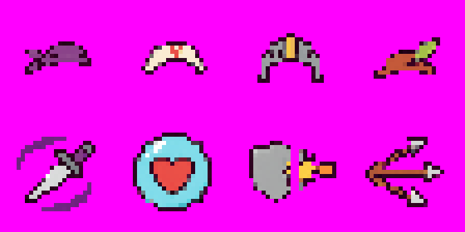

# Art and gameplay directions for Claude

## Keep the six blob shapes

Use the dome as the drawing model. The existing renderer in src/blob.ts already separates wearables from faces and supplies head anchors and three head widths. A single body would save fitting work but would take away a choice children can recognise across the room. First fit one bandana on the dome, flat and tall extremes. If a wide head fails, change only the brim and anchor offset. Test the cube and pear corners before signing off. Check eyes, selected hats and dungeon gear separately because class gear can replace a cosmetic.

## Artwork supplied

[class-frames.png](art/class-frames.png) is a 96 × 192 RGB PNG. Every cell is 24 × 24. Frames run left to right. Rows top to bottom are Rogue bandana, Healer kerchief, Tank helmet, Marksman feather cap, sweeping dagger, heart bubble, shield impact and arrow fan. Background key is RGB(255,0,255). Strip the exact key on import and use nearest-neighbour sampling. The GIF is a preview. The PNG contains the actual authored frames. Only the dome-scale fit is targeted in this first pass. Placement on live bodies remains to be checked.

The bandana tail lifts, the kerchief ends flutter, the helmet catches light and the feather bends. Brims stay anchored. Start from the first frame at rest. Advance cloth frames on a hop or direction change. Keep equipment still when the character stands still. Skill icons may play once on selection, impact or success. Idle cards can share a static first frame. Try the preview timings of 350 / 120 / 180 / 120 ms, then tune on a phone.

## Four class directions

| Class | Existing foundation | Proposed small experiment | What the picture should communicate |
|---|---|---|---|
| Rogue | Sidestep and close-range dagger | **Crosscut.** After a sidestep past an enemy, the next swing cuts back across its path. Test one empowered swing. | Dagger crosses the trail the blob just left. The current sweep is a first icon candidate. |
| Healer | A heal bolt can grant a one-hit shield | **Bubble Catch.** Surface the existing shield upgrade. When it absorbs a hit, show a pop and credit the Healer on both screens. | Heart inside a bubble. Check that the child predicts protection as well as healing. |
| Tank | Holding guard protects the front | **Return to Sender.** A well-timed guard reflects one incoming bolt. Ordinary held guard still works. | Incoming bolt meets the shield. Add an outgoing frame if reflection ships. The supplied impact alone communicates a block. |
| Marksman | Standing still fires, volley can gain extra arrows | **Fan Shot.** First make existing multishot visibly spread. Test a choice against piercing in a corridor. | Three separate arrowheads fan outward. Test whether the player can distinguish this from firing faster. |

## Suggested implementation order

1. Review the gameplay findings in README.md and reproduce joining on two phones. Independently show the four skill images, at actual HUD size, to a child and an adult. Ask what pressing each would do before revealing its label.
2. In a development scene, key and load the atlas once. Use the existing anchor, facing and bob timings to place a wearable layer. Test three blob colours, both facing directions and the extreme shapes. Check for pink fringes and clipping. Change sprite art or per-shape offsets where needed.
3. Ship a small experiment with one wearable and one existing skill first. Compare Bubble Catch and Fan Shot to the current cards during actual play. Keep the other concepts available for iteration.
4. Treat Crosscut and reflection as separate optional gameplay changes with their own co-op and solo tests. Do not label either as an existing unlock. Expand the art set only after players recognise the action at phone size.
