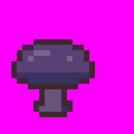

# Glowcap hollow · Carry the clue

The clay-bank bell releases a pale spore trail. It ends at a dark fork where a loose glowcap is the only readable object. One player carries or places the light. Their partner follows the marks that appear inside its pool. A solo player can set the cap down, explore one branch and return to move it.

The existing [shared-screen study](glowcap.html) tests the reasoning loop with two landmarks and two trail choices. It deliberately uses buttons for positions. The game version should make the same information physical: the cap has a small bright radius, trail marks fade outside it, and each player moves their own blob.

## Smallest complete outing

1. **Wake it.** Approaching the dark cap makes it pulse once. Pressing the contextual action lifts it. The carrier glides slightly slower and cannot gather ordinary resources while holding it.
2. **Place it.** Press again to set it at the nearest clear spot. It lights one landmark and the first two marks of a trail. All players see the same marks.
3. **Read together.** The scout follows the revealed mark shape at the fork. The carrier can see the scout silhouette at the edge of the light, then moves or carries the cap to the second landmark.
4. **Recover quickly.** A wrong branch curls back into the fork within three seconds. Dropping the cap in an invalid spot returns it to the last valid placement. A disconnected carrier sets it down.
5. **Find a place, not a currency.** The final leaf lifts to reveal a beetle and a small picnic clearing. The beetle rolls out one berry for immediate play. The persistent reward is the clearing and its shortcut home.

Use two authored trail pairs and avoid randomising within a run. On replay, choose the other pair. Do not show a minimap line or a text instruction. The light should reveal evidence, while the scout decides what it means.

## Jobs that remain useful

| Moment | Light keeper | Trail scout |
|---|---|---|
| First fork | Chooses which landmark becomes readable | Chooses a branch from the visible mark |
| Wrong branch | Keeps the fork lit so returning is easy | Reports the dead end by movement |
| Second clue | Carries or leapfrogs the cap forward | Waits at the next landmark and points with position |
| Discovery | Places the cap in the picnic socket | Lifts the final leaf |

With three to five players, extra scouts can try branches and stand on discovered marks. Only one cap exists, and any nearby player may pick it up after it is placed. The activity never requires two simultaneous actions, so one player can finish it.

## Claude handoff

- Model the glowcap as a dedicated activity prop. Do not put it in the ordinary `carry: ItemKind[]` stack. That stack auto-collects, deposits at home and is encoded as resource letters in snapshots. Carrying the cap needs an owner ID, a valid placement and an activity phase.
- Resolve pickup and drop through the host's existing contextual-action edge. Suppress dash and gather for the consumed press. Held input must not alternate pickup and drop. A carrier leaving the room or disconnecting drops at the last valid point.
- Reserve both forks, landmark pads and the picnic socket before seeded trees are placed. Mirror local coordinates with the chosen water corner. Persist route-pair index, picnic discovery and the cap's last named socket. Rebuild world coordinates from the current seed. Reset a carried cap to that socket on reload.
- Sweep all four water-corner orientations. Include seed 9 as a regression: a naïve top-right fork at (1042, 120) overlaps a solid tree near (1067, 121). Reserve each clue pad, its interaction approach and the walking corridor before generating nodes.
- Include cap state, carrier and revealed trail stage in the host snapshot. A late joiner must see the same marks. Reveal is a function of host state and cap position, never a client-only lighting decision.
- Mark discovery dirty immediately. The current host save is throttled for up to two seconds and hides storage failures, so expose pending/saved/unavailable feedback before treating the picnic as a dependable resume point. Repeating the search may replay the beetle animation and produce a berry only if that reward follows the normal round economy. It must not award the persistent discovery twice.

## Family test

Start with the labels hidden in the study and let the child touch the first control. Ask no route question until somebody points at a mark. Record whether players use location words, wait for each other at the edge of the light, and voluntarily swap the cap after one search.

The success signal is a player saying where the other person should put the light, followed by the other player changing its position. If one person operates both jobs while the partner watches, shorten the distance between the fork and the second landmark. If both guess without consulting the marks, make the two shapes more different before adding another route.

## Sprite handoff

The [native strip](art/glowcap-carry.png) contains four 24 × 24 cells. They show dormant, lifted, placed and trail-revealing states. The cap stays the same object across frames. Use exact RGB(255, 0, 255) as the key and nearest-neighbour scaling. The GIF is a review loop. In game, play wake once and hold the placed or revealed frame according to host state.
