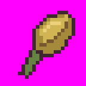

# Meadow progression · New verbs before bigger bars

The current village economy turns wood and berries into buildings, then asks for larger quantities. The expedition chain should progress differently. Each discovery gives the family a new action, leaves a visible change in the meadow and adds one small object to the cottage display. The display answers “what did we find?” when the family returns.

## Three discoveries, three resources

| Tier | Discoverable resource | New verb | First shared outcome | Persistent proof |
|---|---|---|---|---|
| 1 · Water | Reed seedpod | Launch and redirect | Plant a bounce flower | Open seedpod on a woven cottage shelf |
| 2 · Earth | Soft clay | Shape and roll | Tip the shortcut log or ring the seed bell | Fired clay spiral beside the shelf |
| 3 · Light | Glow spores | Carry and reveal | Find the beetle picnic clearing | Hanging glow jar outside the cottage |

These resources are capability tokens. The first meaningful use records the discovery for the whole village. They do not enter the ordinary wood, stone and berry bank, quest bars or carry limit. Renewable copies stay at their landmarks for replay. This keeps “new resource” associated with a new way to play instead of another number to fill.

The cottage display fills left to right in discovery order. Touching an object pulses the related landmark at the edge of the screen and shows one action picture. A guest may use every discovery the host has. A guest’s own village is unchanged.

The [native token strip](art/discovery-tokens.png) contains six 24 × 24 cells. Each pair shows before and after discovery for reed, clay and glow. Use the odd cells as cottage-display icons. The GIF is a sequential review preview rather than an in-game timeline. Key out exact RGB(255, 0, 255) and scale with nearest-neighbour sampling.

## Unlock spine

| After this outcome | Reveal next | Player-facing clue |
|---|---|---|
| Repair the crossing | Reed pool | Bobbing seedpod and tangled raft |
| Plant the first flower | Clay bank on the next visit | Round tracks ending at a ditch |
| Ring the seed bell | Glowcap hollow | Pale spores trailing into darkness |
| Find the picnic clearing | Three return projects | Project silhouettes beside the cottage |

The replay checks are playtest gates for development. In the shipped game, a family does not lose access because it stopped after one attempt. Complete the first flower to reveal clay tracks on the next visit. Ringing the seed bell reveals Glowcap even if the log remains upright. The log is a useful shortcut and a second reason to return.

## Return projects

After the picnic discovery, the family chooses one visible project for the next outing. Pin its silhouette beside the cottage and show its two required discoveries as pictures.

| Project | Combines | What players do together | Lasting result |
|---|---|---|---|
| Seed sail | Reed + Glow | One turns a wind vane while another catches a drifting seed | A second flower route back to the village |
| Lantern stepping stones | Clay + Glow | One places clay cups while another carries the cap to light the safe order | A lit evening path to the picnic |
| Beetle berry run | Reed + Clay | One aims a reed chute while another reshapes a clay bank | The beetle visits the cottage garden |

Choosing a project changes the next expedition. It does not consume the discovery tokens. Completing one leaves the other two available for later sessions. Do not present all three before the picnic, when the family has no memory of the ingredients.

## What tiering up changes

- **Tier 0** offers gathering, a carry chest and the broken crossing.
- **Tier 1** adds routes that move without a blob. The family predicts where cargo will go.
- **Tier 2** adds a world object whose shape changes an outcome. The family plans a shot.
- **Tier 3** adds information visible only near a movable light. The family communicates a route.
- **Return tier** combines two learned verbs. It should feel like mastery of familiar tools, not a fourth tutorial.

Every tier keeps its landmark playable after completion. Repeat play produces movement, shortcuts, berry rewards or decoration. It never produces a second permanent unlock from the same first discovery.

## Save and recap contract

Extend the village save with optional validated discovery state. Preserve existing v2 saves by defaulting each field independently.

| Field | Valid values | Resume behaviour |
|---|---|---|
| Reed | undiscovered, flower at bridge, flower at bank | Ready seed at launch; rebuild flower relative to the current water corner |
| Clay | unseen, revealed, low ramp, high ramp plus log/bell flags | Stone ready at home groove; restore targets independently |
| Glow | unseen, revealed, picnic found plus route index | Cap at last named socket; no carried or half-followed trail |
| Project | none, one chosen ID, completed IDs | Rebuild its silhouette or permanent result |

At session end, recap the newest visible change first. “Flower by the bridge” or “Seed bell ringing” replaces empty stars. Under it, show one picture of the next clue. If storage is unavailable, keep play running and say that the discovery will last for this visit.

The host owns discovery, activity and project state. Snapshots include active phases for late joiners. Saves contain settled landmarks and named sockets, never world coordinates, in-flight objects or carrier IDs. Reconstruct positions from the fresh seed and reserve every landmark footprint before ordinary nodes are generated.

## Build order for Claude

1. Add the three discovery records and a cottage display that can render locked silhouettes. Migrate old saves without clearing buildings or banked resources.
2. Build Reed alone and test reconnect, reload, both planting locations and immediate replay. Keep Clay and Glow locked behind debug flags.
3. Add Clay after a family starts another reed launch without prompting. Test both target orders and a seed change.
4. Add Glow after players use the clay choices to predict a shot. Test a real carried light with two phones.
5. Offer the three return projects only after families can explain what reed, clay and glow each let them do.

Do not add expedition materials to Res, ACTIVE_RES, quest goals or build prices during these tests. That would change the meaning of current progress bars before the new actions prove enjoyable.

## Checkpoint · 18 November 2026

This progression spine links [Reed pool](MEADOW.md), [Clay bank](CLAY-BANK.md) and [Glowcap hollow](GLOWCAP-HOLLOW.md). The next validation is a family session using two phones. The deciding evidence is whether players name a next outing from a world change they made, rather than asking which bar still needs filling.
