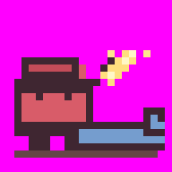

# Rescue credit · Show who helped whom

A heal-mode Healer bolt already wakes a knocked-out friend instantly at half health. It auto-targets the most urgent other teammate in range; there is no manual aim input. In the reviewed source simulation, a Healer revived a 140-HP Tank at 70 HP, but the shared `revive` effect contains only the target ID. The spirit puff, hop and heart therefore celebrate the Tank without identifying the Healer whose mode choice and positioning mattered.

## One rescue, three readable views

Keep the existing world effect, then add a short identity cue sourced from the same host event:

| Viewer | Personal line | Shared world cue |
|---|---|---|
| Healer | **You helped Tank up** | A heart ribbon travels Healer → Tank |
| Revived Tank | **Healer helped you up** | The same ribbon and Tank's happy hop |
| Other teammate | **Healer helped Tank up** | The same ribbon, no extra modal |

Use player names and current blob colours, but never rely on colour alone. Hold the personal line for about two seconds above the dungeon HUD, outside the movement area. If another rescue occurs, queue the line briefly rather than covering the revived player's health or the room-exit cue.

Automatic recovery is intentionally different. After the normal five-second countdown, or three seconds when a standing hero owned **Friends get up sooner** at the fatal hit, show **Tank got back up** with no rescuer, no heart link and no credit. That card changes passive team recovery; it does not perform the bolt rescue.

Open [rescue-credit.html](rescue-credit.html) for the deterministic rehearsal. Knock out Tank, switch the wand to heal mode and advance the automatic bolt. Compare both personal lines. Reset and let the five-second timer finish to confirm that automatic recovery cannot award credit. The study fixes the Healer inside range with clear sight; movement and obstacles remain part of the live targeting rule.

## Preserve the real rules

- A heal-mode staff bolt has 170-world-pixel centre-to-centre reach, chooses a knocked-out other friend before an injured standing friend and requires line of sight. Equal KO priorities currently follow body iteration order.
- A bolt rescue sets `ko = 0`, restores `max(1, round(maxHp / 2))` and grants 1.5 seconds of invulnerability. It does not add the ordinary 10-HP heal on top.
- The older Healer light has 150-world-pixel radius and may rescue several friends. Each rescued target needs its own credited event from the same Healer.
- Automatic recovery after `KO_SECONDS = 5` returns the player at full health to the room start with two seconds of invulnerability. **Friends get up sooner** subtracts two seconds while a standing holder exists.

## Claude handoff

- Extend only authored rescue effects: `{ t: 'revive', id: targetId, by: healerId, cause: 'wand' | 'light', x, y }`. The host emits this at the exact state transition already used by the heal bolt or light. Keep `by` and `cause` optional for older event consumers and passive recovery; no continuous snapshot field is required for this transient cue.
- Leave timer, next-room and other system wakes as `{ t: 'revive', id, x, y }`. The renderer treats a missing `by` as uncredited recovery and never guesses from class membership.
- Resolve names and colours from the current player roster when rendering. If the Healer disconnects after the event, the event still carries their stable ID; use the last known display name for its two-second lifetime. If either ID is unknown, fall back to **A friend helped Tank up**, not a blank or raw ID.
- Send the same transient FX event to every phone. Personalise only the pronouns against `session.myId`. Do not save rescue history in the village or replay the banner to a late joiner; this is immediate combat feedback.
- Draw the link in world space between the two authoritative positions captured at rescue time. Clamp off-screen endpoints to a small edge chevron so the Tank still knows the help came from a teammate outside the camera.
- Add Swedish and English message keys for self, target, observer, unknown helper and uncredited recovery. Screen readers should receive the personal line once through the existing live status region; the decorative ribbon stays hidden from accessibility APIs.

## Acceptance

Test bolt rescue, multi-target light rescue, passive five-second recovery, three-second **Friends get up sooner** recovery, two Healers, two simultaneously knocked-out friends, the Healer being KO'd immediately after firing, disconnect after emission, unknown/escaped names, duplicate FX delivery, late join after rescue and off-screen endpoints. Verify exactly one credit per actual `ko > 0 → 0` transition and none for ordinary healing, regeneration or passive wakes.

At 390 × 844 portrait and short landscape, keep both health panels, KO countdown and the personal line readable without blocking the attack control. Ask the Healer and rescued player separately, “Who changed what?” A successful cue produces “I got Tank up” and “Healer got me up,” not merely “a heart appeared.”

## Sprite handoff

The [native strip](art/rescue-credit.png) contains four 24 × 24 authored frames: downed friend, connecting bolt, rising friend and credited pair. Key out exactly RGB(255, 0, 255) and use nearest-neighbour scaling. Keep the final linked pose visible long enough to read alongside the personal line. This is distinct from the accepted clock animation for passive **Friends get up sooner**; the bolt picture represents auto-targeted wand fire, not a manual aiming control.

## Checkpoint · 19 November 2026

Rescue now has actor-aware event semantics, differentiated passive recovery, a playable two-view rehearsal, authored frames and multiplayer/accessibility acceptance cases. Live auto-target positioning, HUD placement, two-phone timing and family comprehension remain open.
