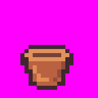

# First return project · Lantern stepping stones

Build this return project first because it recombines two learned actions without adding another resource counter. Clay changes shape. Glow reveals information. Together they create a permanent evening path from the cottage to the picnic clearing.

## The shared job

Two muddy gaps each have one soft clay cup and two obvious sockets. At the viewing bowl, the light keeper sets down the Glowcap. A symbol appears for the next gap: round or pointed. The clay shaper presses the waiting cup into that silhouette. A match fires the cup into a glowing stepping stone. A mismatch slumps back into soft clay and can be reshaped immediately.

The light keeper reveals one symbol at a time. After the first cup, ask the players to swap jobs. Both move along the path, so nobody stays behind operating a remote switch. A solo player sets down the light, shapes the cup and picks the cap up again.

Open [lantern-path.html](lantern-path.html) for the shared-screen rehearsal. Give one player the Light panel and the other the Clay panel. The screen exposes both panels, so ask each to operate only their own controls. This checks the conversation and recovery loop. It does not test private information.

## Why this is the first combination

- It reuses the named Glowcap prop and two clay silhouettes already established by the resource tiers.
- Every correct answer becomes part of the route. The payoff is visible during construction.
- A mistake costs one press and creates a wobble, so a younger player can test a guess safely.
- Completion shortens a real return trip and adds warm light to a place the family remembers.

The first path contains two gaps so both players can perform each job once. On later visits the symbols rotate, while the fired cups remain safe. Replaying lights optional side cups that reveal beetle decorations or berries. It never removes the shortcut.

## Claude handoff

- Store a project ID, two fired-cup bits and completion. Keep the current clue index, carried light and soft candidate shape in the host snapshot only. On reload, reset the Glowcap at the last named bowl and keep fired cups.
- Resolve reveal and reshape through the same contextual-action selector used by Reed, Clay and Glow. One fresh press performs one state change. Held-tool repeat, auto-gather and dash cannot consume the same press.
- Reserve both approach sides of every cup, the walking landing and the completed shortcut before seeded nodes are generated. Mirror named sockets from the selected water-corner layout. Sweep all four corner orientations and a reseed within one orientation.
- A disconnected light keeper drops the cap at the current viewing bowl. Any player may continue. Simultaneous shape presses resolve once in stable player-ID order. A late joiner sees the current clue and already fired cups.
- Mark each fired cup dirty so partial progress survives. Surface pending, saved and unavailable states. Completing the second cup records the project before the celebration starts.

## Acceptance

Test all four two-symbol routes, a wrong shape at either station, solo role switching, two players pressing different shapes on one tick, a disconnect while carrying light, reload after the first fired cup, and unavailable storage at completion. At 390 px, both role panels and the current gap must remain visible without horizontal scrolling.

The success signal is the light keeper describing a symbol and the clay shaper responding without taking over the other controls. After completion, ask which earlier discovery supplied each half of the solution.

## Sprite handoff

The [native strip](art/lantern-cups.png) contains four 24 × 24 cells showing an empty clay cup, the placed cap, a lit cup and revealed stepping marks. Key exact RGB(255, 0, 255) and use nearest-neighbour scaling. The GIF is a review sequence. In game, hold the fired-cup frame permanently and emit the marks only while the relevant viewing bowl is lit.
