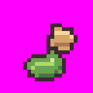

# Seed Sail · Choose where the shortcut grows

This return project combines Reed and Glow after the picnic discovery. The family chooses one of two useful flower landings. One player lights a nearby destination beacon and reveals its wind ribbon. The other trims the seedpod’s reed sail before the marked bend in its flight.

## One permanent choice

| Glow beacon | Wind ribbon | Matching reed sail | Lasting shortcut |
|---|---|---|---|
| Cottage | Straight tailwind | Tailwind sail | Flower launches from the cottage toward the picnic |
| Reed pool | Bent crosswind | Crosswind sail | Flower launches from the pool toward the bridge |

The first matching landing waits for an explicit **Plant** or **Return** choice. Plant records the project flower's location; Return rehearses the route without changing the village. The other landing remains a replay target, while the permanent shortcut stays where the family chose it. Moving the flower later should be a separate, explicit choice at the cottage display rather than an accidental replay result.

A mismatch returns safely. Cottage with a crosswind sail drifts into a soft meadow loop. Pool with a tailwind sail overshoots into the existing eddy. The seedpod returns to the sail table with both settings visible. No resource is lost.

Open [seed-sail.html](seed-sail.html) for the shared-screen rehearsal. Give one player the Beacon panel and the other the Sail panel. The light keeper names the destination and revealed ribbon; the sailor may pre-trim or change the sail while the seed is airborne. At **Cross marked bend**, the host samples that trim once and follows the authored route. A solo player can pre-trim and launch under the same rules.

## Why it differs from Reed pool

- Reed pool asks players to redirect moving cargo and catch it downstream.
- Seed Sail asks the family to choose a permanent destination and communicate a final trim while the seed is moving.
- Glow reveals destination-specific wind information. It is more than a coloured target.
- A successful launch changes travel through the meadow rather than producing another collectible.

Keep both destination sockets beside the shared launcher so the beacon and seedpod remain within one phone camera framing; their cottage and pool silhouettes name the eventual route rather than remote errands. The light keeper should see the chosen sail change. The sailor should see the wind ribbon appear at the beacon.

## Claude handoff

- Keep the seedpod, sail rig and Glowcap as project props outside ordinary inventory, bank and quests.
- The host accepts a beacon while ready and a sail trim while ready or in flight. At the marked bend it captures the current trim once; later changes cannot alter that attempt. Resolve a same-tick trim before the bend sample.
- Persist project completion and one landing ID only when the family presses Plant after a matching landing. Do not persist active flight, owner IDs, world coordinates, temporary replay landings or a returned seed.
- Include beacon, current trim, captured trim, attempt ID, flight phase and elapsed path in snapshots. Late joiners must see the same ribbon and flight. A disconnect leaves an active flight running; the nearby beacon remains lit for that attempt.
- Derive both beacon, table, recovery and flower sockets from the seeded water-corner layout. Reserve their approaches and all flight landing footprints before generating nodes.
- Use the common contextual-action choice and one physical press edge. Held tool repeats, auto-gather and dash cannot also set, lift or launch.

## Acceptance

Test all four combinations, pre-trim and in-flight trim, trim immediately before and after the bend, same-tick trim and bend, both permanent landing choices, Plant and Return, mismatches followed by one changed setting, solo play, role swap, duplicate launch, late join, disconnect midflight, reload before landing, reload after each permanent choice, unavailable storage and all four corner orientations. Verify that replay cannot silently relocate the saved flower.

Ask which landing the family wants before showing the matching sail. The project succeeds when they discuss both the route they want and the wind information supplied by the other player.

## Sprite handoff

The [native strip](art/seed-sail.png) contains four 24 × 24 cells showing ready, beacon, flight and flower states. Use exact RGB(255, 0, 255) as the key and nearest-neighbour scaling. The GIF is a review loop. In game, the host flight path drives the airborne frame, and the chosen flower frame remains in the world.

## Checkpoint · 19 November 2026

The third return project now has a deterministic rehearsal, two meaningful permanent destinations and an implementation handoff. Real movement, camera framing and two-phone communication remain open.
