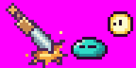

# Dungeon skill cards for a family sharing a phone-sized battlefield

Design handoff, 18 November 2026. Checked against the class, input and card definitions in [dungeon.ts](../../../src/dungeon.ts), the [player-facing labels](../../../src/i18n.ts) and [controls](../../../src/controls.ts). The table describes current effects on the reviewed branch. Suggested names, drawings and encounters are proposals. Recognition and fun need a family playtest.

## Fix three misleading promises first

1. **Marksman.** The existing More arrows upgrade selects two extra Volley targets. An image of five arrows hitting one boss would promise a boss damage upgrade. Rename it **Two more targets**. Put one bolt in each of three distinct slime silhouettes. Reserve a fan of projectiles for an actual spread shot. This supersedes the Fan Shot art recommendation for the current card in DIRECTIONS.md.
2. **Tank.** Stronger shield raises damage globally. Rename it **Heavier hits** and draw the sword landing hard. Keep a shield icon for an effect that changes what guard does. The player should be able to guess which button to try after choosing a card.
3. **Healer.** Faster revive shortens the team's automatic recovery while the Healer is standing. The aimed heal bolt already revives instantly. Call the card **Friends get up sooner**. Draw a fallen ally getting back up beside a clock. Save the heart-in-bubble icon for a bolt that actually shields someone.

## Make each family's first upgrade a decision they can try in the next room

| Class | Existing choice to put side by side | Tiny encounter | What a teammate might say |
|---|---|---|---|
| Marksman | Pierce vs extra volley targets | Two enemies overlap in a lane, then three spread apart. A partner can draw enemies into line while the shooter repositions. | “Bring those two this way!” |
| Healer | Shield bubble vs stronger attack bolt | A slow projectile approaches a friend. Allow time to switch wand mode and land one heal. Give attack mode a useful target immediately afterwards. | “I saw the bubble pop. Do it again.” |
| Rogue | Bigger whirl vs harder push | Put a pair near the Tank and a third enemy just outside normal whirl reach. Let the Rogue choose between catching all three and making space around their friend. | “I’ll get them off you.” |
| Tank | Safe charge vs longer stun | A visible ranged enemy starts winding up behind the front line. Charge through the approach or help hold the front enemy still for an ally. | “I'll take the one at the back.” |

Try these with existing effects first. Use a predictable enemy placement for the test. Each player should be able to describe one thing they did differently because of their choice. Give the Healer a solo alternative while testing ally-targeted choices. Drawing a bubble never solves a card that has no available recipient.

## Icon brief for the current 24 cards

Read each row as current effect → proposed drawing. Keep the weapon recognisable in the first frame. Use a different silhouette for time, distance, targets and impact. Reserve a heart for health. An arrow used as a motion mark should have a visibly different outline from a crossbow bolt.

| Class | Current effect | Drawing to test |
|---|---|---|
| Rogue | Shorter basic attack interval | Dagger with a tight pair of slash marks |
| Rogue | Greater knockback | Enemy pushed away from a planted blade, gap visible |
| Rogue | Larger whirl radius | Blob at centre of a wide circular slash |
| Rogue | Higher maximum HP | Heart in an expanded outline, same health symbol as Tank |
| Rogue | Heal on kill | Enemy splat releasing one small heart toward the Rogue |
| Rogue | Higher damage | Dagger buried in a chunky impact star |
| Healer | Higher healing per bolt | Wand bolt entering a large heart |
| Healer | Periodic self-heal | Heart looping back into the caster |
| Healer | Heal bolt gives a one-hit shield | Ally enclosed in a bubble with a single bright rim |
| Healer | Shorter automatic ally recovery | Fallen ally rising beside a clock |
| Healer | Higher attack bolt damage | Wand bolt breaking on a target |
| Healer | Shorter bolt interval | Wand with two close-spaced pulses |
| Marksman | Two extra volley targets | Bolts striking distinct targets |
| Marksman | Basic bolt pierces another target | One straight bolt passing through two silhouettes |
| Marksman | Higher critical-hit chance | Single bolt in a bullseye with a small impact star |
| Marksman | Shorter firing interval | Crossbow releasing two successive bolts |
| Marksman | Basic bolt stuns | One bolt pinning one snowflake |
| Marksman | Volley stuns | Several separate targets each bearing a snowflake |
| Tank | Charge grants brief invulnerability | Shield leading a dash through a small incoming bolt |
| Tank | Higher enemy targeting preference | Two enemy eyes turned toward one shield |
| Tank | Higher maximum HP | Shared expanded-heart symbol |
| Tank | Higher damage | Sword striking a chunky impact star |
| Tank | Longer stun | Stunned enemy with a clock |
| Tank | Shorter sword interval | Sword with two close-spaced slash marks |

## Small art batch and test

Draw only the three misleading cards first, plus Pierce as a visual foil for the volley. Use the existing 24 × 24 cell convention, exact #FF00FF outside the art, and a two- or four-frame authored loop. The resting frame must carry the meaning whenever the phone shows a still card. Use movement to clarify it: Pierce travels through a second target along one line. Volley strikes separate targets. Heavier hits pauses on impact. Recovery moves the ally from down to standing.

Present each pair at real card size with the label covered. Ask “Which would you pick here?” Show the room and let the player point. Then reveal the label, play the encounter and ask “What happened when you used it?” Record the mistaken prediction verbatim. If both players predict five hits against one boss, redraw the Volley icon before expanding the set.

Acceptance for Claude: verify every final label in Swedish and English against the active input or stat modifier. Check the card adjacent to its closest lookalike on a phone. Account for players who see only frame one. Leave the other twenty images until these four can be distinguished in play.

## Checkpoint · Tank damage and Healer recovery · 18 November 2026

[Native frame sheet](art/impact-recovery.png). Each row contains four 24 × 24 cells, read left to right. The top row is Tank, the bottom row Healer. Frame one is the still card. On selection, play the four frames once. The GIF loops for review. Key out exactly RGB(255, 0, 255) before putting a cell over its class badge.

| Card ID | Suggested label in English / Swedish | What to look for |
|---|---|---|
| `tank-charge` | Heavier hits / Hårdare träffar | One sword lands a heavy blow. The card gives a 1.3× damage multiplier. Hold the impact pose so the loop reads as force rather than faster attacks. |
| `healer-revive` | Friends get up sooner / Vänner kvicknar till snabbare | A clock ticks as a flattened ally gets up. One copy held by a standing Healer when the ally falls shortens automatic recovery from five seconds to three. An aimed healing bolt already revives on contact. |

**Phone test for Claude.** Show the still frame at 48 CSS px inside the existing badge, then at 36 px in short landscape. Cover the label and ask each player separately, “What changes when you pick this?” Write down their first answer. If they predict a faster swing, a stronger shield, or a healing spell they must aim, show the animation once and ask what changed their mind. A correction after playback identifies a still frame that needs another pass. Source sizes come from [dungeon.css](../../../src/dungeon.css) and the effects from [dungeon.ts](../../../src/dungeon.ts).

The four priority card studies now cover Pierce, Volley, Tank damage and Healer recovery. Family recognition on a phone remains open. For the next independent meadow deliverable, develop the clay-bank discovery and its two ramp outcomes using the reed-pool replay criterion in [MEADOW.md](MEADOW.md).

## Playable Healer comparison · 18 November 2026

Open [healer-study.html](healer-study.html). It compares the current Shield bubble and Stronger wand modifiers in one short sequence: heal a friend before an incoming bolt, then switch modes and attack the goo. The study preserves the current numbers. A heal bolt restores 10, the bubble blocks one hit, and the 1.4× wand modifier raises an 8-damage attack bolt to 11 after rounding.

Run both cards with labels covered, swap their positions, and play the authored icon frames only after the first prediction. The useful observation is whether players describe protection versus attack strength before seeing the result. Movement, targeting and cooldowns are intentionally removed. Phone touch, timing under combat pressure and whether a solo Healer values the ally-dependent bubble remain open.

## Playable Tank comparison · 18 November 2026

Open [tank-study.html](tank-study.html). It compares Safe charge with Stun in a fixed lane where a front goo ends the charge early and a ranged goo has already fired. Safe charge adds 0.4 seconds of dodge state, which can outlast the early collision. Stun adds 0.6 seconds to the sword’s normal 0.25-second stun.

Run both cards with labels covered and swap their positions. The study asks whether the family predicts protection from the first card and longer enemy control from the second. It fixes one incoming shot at 20 damage and reduces continuous movement to steps. Real projectile timing, charge distance and whether Safe charge adds noticeable protection in ordinary rooms remain open.
